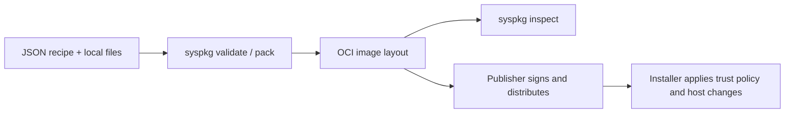

# System Package

Define host software in one JSON manifest, then bundle it with named files and
systemd extension images in an OCI image layout. This repository provides the
Go library and `syspkg` CLI for package authors and installer integrators.



`syspkg` works locally. Validation checks the format and resource references;
inspection also checks package digests and sizes. Signing, registry transfer,
installation approval and host execution belong to your publisher and installer.

## Create your first package

Install with Go **1.26.6 or newer** and ensure `$(go env GOPATH)/bin` is on your
`PATH`:

```sh
go install github.com/kappliance/system-package/cmd/syspkg@latest
```

From a checkout of this repository, package the included text file:

```sh
syspkg validate examples/hello/recipe.json
syspkg pack --recipe examples/hello/recipe.json --output ./layout \
  --blob message=examples/hello/message.txt
syspkg inspect ./layout
```

The output directory must not exist. `pack` preserves the recipe bytes and emits
an OCI layout with one image manifest, the recipe as config, and named raw layers.
`inspect` prints JSON containing `manifestDigest`, `recipeDigest`, `recipe` and
`layers`. A successful exit means its bytes and declared inventory agree. The
example installs nothing on your machine.

The example recipe is complete:

```json
{
  "version": "v1",
  "component": "hello",
  "platforms": [{"os": "linux", "architecture": "amd64", "adapter": "stock-systemd"}],
  "files": [{"name": "message", "path": "components/message.txt", "blob": "message"}]
}
```

## Package a systemd extension

Add a prebuilt systemd extension image to the same recipe:

```json
"sysexts": [{"name": "runtime", "blob": "runtime-image"}]
```

Provide its raw image bytes when packing:

```sh
syspkg pack --recipe recipe.json --output ./runtime-layout \
  --blob runtime-image=./runtime.raw
```

This command requires your own complete recipe and image. `syspkg` packages an
existing image; it does not build or mount it. The installer determines image
naming, compatibility with the host, discovery, refresh and service lifecycle.
Systemd extensions affect `/usr` and `/opt`; host configuration and private inputs
remain separate resources. The format imposes no systemd version gate. Qualify
the host capabilities and image metadata required by your installer.

## Use the Go library

```go
import systempackage "github.com/kappliance/system-package"

recipe, err := systempackage.Decode(recipeJSON)
if err != nil {
    return err
}
_ = recipe // Validated recipe for your installer.
pkg, err := systempackage.Pack(outputDir, recipeJSON, map[string]string{
    "message": "message.txt",
})
```

`Decode` already invokes `Validate`; call `Validate` directly for Go values you
construct yourself. `Inspect(layoutDir)` verifies a local layout without
extracting or executing payloads. `Schema()` returns an independent copy of the
embedded [JSON Schema](schema/recipe.schema.json). Installer policy, signature
verification and platform qualification are deliberately separate from format
validation.

## Format and integration

Read the [format contract](docs/format.md) for resources, templates, OCI media
types and limits. The Go module path is `github.com/kappliance/system-package`;
the package identifier is `systempackage`. The
[Node Installer Operator](https://github.com/kappliance/node-installer-operator)
consumes this library and applies its own supported profiles and trust policy;
access to that separate repository may be restricted.

[GitHub Releases](https://github.com/kappliance/system-package/releases) contains
release information. Source builds and checks:

```sh
go test -race ./...
go vet ./...
go build -o ./bin/syspkg ./cmd/syspkg
```

Licensed under [Apache-2.0](LICENSE).
